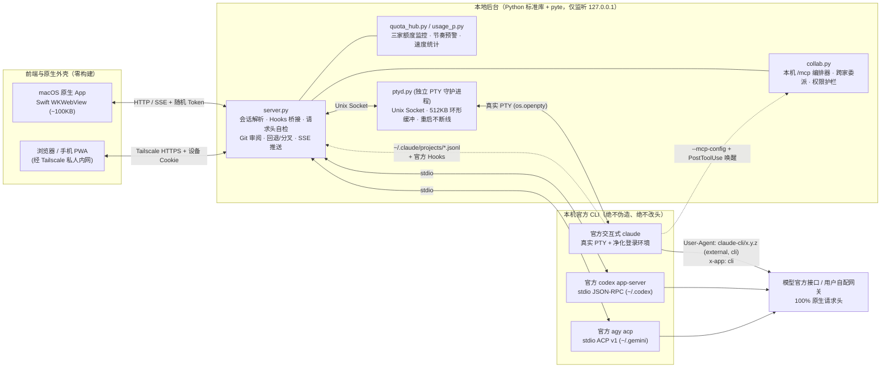
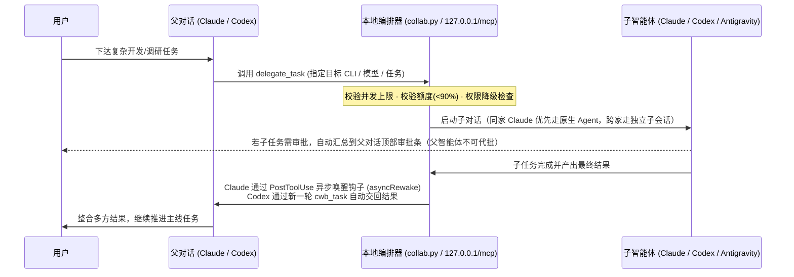

<div align="center">

# 以 PTY 不改变模型请求头的方式运行 CLI
### Claude 工作台 · `pty-cli-workbench`

**超轻量（~4 MB 源码 · 仅 1 个 Python 依赖）的原生桌面多 CLI 工作台**
**真实伪终端（PTY）原样运行官方交互式 CLI · 不调 SDK · 不改模型请求头 · 远离第三方调用风控与封号风险**

[](./LICENSE)
[](#对比其他开源客户端为什么选择本项目)
[-ea580c.svg)](./requirements.txt)
[](#一核心特色为什么不改变模型请求头如此重要)
[](#二多-cli-统一工作台与跨家多智能体协同)
[](#八快速开始与部署)

[核心原理与防封号设计](#-一核心特色为什么不改变模型请求头如此重要) ·
[与 T3 Code / Pi 对比](#-对比其他开源客户端为什么选择本项目) ·
[多智能体协同](#-二多-cli-统一工作台与跨家多智能体协同) ·
[完整功能全景](#-三完整桌面工程化能力全景) ·
[Tailscale 远程控制](#-六tailscale-远程控制手机随时操控) ·
[快速开始](#-八快速开始与部署)

</div>

---

## 项目简介

市面上已经有越来越多给 AI 编程 CLI 套壳的桌面客户端（如 **T3 Code**、**Pi** 以及各类 Electron / Tauri 客户端），但它们普遍存在两大痛点：

1. **体量庞大、黑盒臃肿**：动辄打包整个 Electron + Chromium + Node.js 运行时与数百个依赖，安装体积轻松达到 **数百 MB 甚至 1 GB+**，内存占用高、构建复杂、难以审计每一行进程和网络调用。
2. **改变模型请求头，存在封号/风控风险**：为了拿结构化输出，大量客户端选择调用 **Agent SDK**（如 `@anthropic-ai/claude-agent-sdk`）、无头模式（`claude -p`），甚至通过第三方反代 / 抽取 OAuth Token 自行构造 HTTP 请求。无论是 **Claude（Anthropic）** 还是 **Antigravity（Google）**，一旦服务端检测到异常请求头、SDK 第三方调用标识或非官方客户端指纹，订阅账号就可能面临**限流、鉴权拦截甚至封号风险**。

**本项目（`pty-cli-workbench`）走了一条完全不同的路：**

- **体量极小**：整套源码仅 **~4 MB**（`.git` 压缩仅 ~3.3 MB），后端使用 **Python 3 标准库 + 唯一外部依赖 `pyte`**，前端 **零构建、零 `node_modules`**，macOS 原生桌面壳仅 **~360 行 Swift `WKWebView`**（编译后约百 KB）。
- **请求头零改动**：用独立伪终端守护进程 [`ptyd.py`](./ptyd.py) 原样拉起本机官方交互式 `claude`，与你在系统终端手动敲 `claude` **完全一致**；同时通过各自本机官方 CLI 原生接入 **Codex** 和 **Antigravity**，**绝不代理、绝不篡改任何模型 HTTP 请求头、绝不抽取凭证**。
- **能力毫不妥协**：在几 MB 的体量里，完整实现了 **多智能体跨家协同（Claude / Codex / Antigravity 互派任务与代码复核）**、**重启不断线的 PTY 守护进程**、**三家统一额度与速度中心**、**每轮代码回退与任意轮次分叉**、**Git 行内字符级 Diff 审阅**、**Tailscale 手机远程 PWA 操控**、**Claude 反向操作工作台界面与离屏截图自检** 等全套重度工程化能力。

---

## 一、核心特色：为什么「不改变模型请求头」如此重要？

### 1. 第三方客户端为什么会触发风控 / 封号？

无论是 **Claude** 还是 **Antigravity**，官方对个人/订阅账号的客户端校验都在持续收紧，服务端重点识别以下异常特征：

| 风险来源 | 常见第三方项目的做法 | 造成的直接后果 |
| :--- | :--- | :--- |
| **SDK 调用头污染** | 使用 `@anthropic-ai/claude-agent-sdk` 或 headless `-p --output-format stream-json` 驱动 Claude | 发往上游的 `User-Agent` 变为 `claude-cli/<ver> (external, sdk-ts)` 或附带 `CLAUDE_AGENT_SDK*` 标识，与正常交互式 CLI 明显区分 |
| **第三方反代 / 伪造请求** | 抽取本机 OAuth 令牌，通过自写 HTTP 客户端或第三方中转直接请求 Claude / Antigravity 接口 | 丢失官方客户端真实 TLS/HTTP 指纹、缺失或篡改官方请求头，极易触发账号异常检测与封禁 |
| **宿主环境变量泄漏** | 从 IDE/Electron 父进程直接 `spawn` CLI，未清理父进程注入的变量 | `CLAUDE_CODE_*`、`CLAUDE_AGENT_SDK*`、`VSCODE_*`、`TERM_PROGRAM` 等变量透传进 CLI，改变官方 CLI 的默认上报特征 |

### 2. 本项目如何做到 100% 字节级原样请求头？

#### ① Claude Code：真实 PTY 交互运行 + 环境彻底净化 + 官方 Hooks 桥接

- **真实伪终端启动**（[`ptyd.py`](./ptyd.py)）：调用 `os.openpty()` 创建真实伪终端，经 `os.setsid()` + `ioctl(TIOCSCTTY)` 建立独立控制终端，直接 `execvp` 执行官方交互式 `claude`。**不调 SDK、不加 `-p`、不挂代理、不拦截任何发往模型服务端的 HTTP 流量**。
- **启动前剥离所有宿主环境变量**（[`server.py`](./server.py) `capture_login_env()`）：从干净登录 Shell 获取基础环境后，显式剔除 `CLAUDE_CODE_*`、`CLAUDE_AGENT_SDK*`、`VSCODE_*`、`CLAUDECODE`、`CLAUDE_PID`、`CLAUDE_EFFORT`、`TERM_PROGRAM`、`TERM_PROGRAM_VERSION`，确保运行环境与你新开一个系统 Terminal 完全一致。
- **工作台只做三件非侵入的事**：
  1. **只读解析历史**：读取 `~/.claude/projects/` 下官方 CLI 自己落盘的 JSONL 会话记录，渲染成现代桌面时间线；
  2. **安全写入终端**：将输入框文本与附件路径过滤异常控制字符（防止粘贴注入提前闭合 bracketed paste）后送入伪终端；
  3. **官方 Hooks 桥接**：通过 `--settings` **仅对当前会话**挂载 CLI 官方支持的 `PermissionRequest`、`UserPromptSubmit`、`Stop`、`StopFailure`、`Notification`、`PreCompact` / `PostCompact` 等钩子，**绝不修改你的全局 `~/.claude/settings.json`**。
- **切换模型 / 思考强度不改全局配置**：通过 `--model`、`--effort` 按对话启动参数隔离，绝不调用会篡改全局默认值的 `/model`、`/effort`。

#### ② 实测请求头 & 内置一键「请求头自检」

本项目不靠口头承诺——我们在 [`usage.py`](./usage.py)（`CaptureGateway`）与 [`server.py`](./server.py)（`ua_check_run()`）中内置了**纯本机零外发抓包自检工具**：

1. 在界面点击 **设置 → 请求头自检**；
2. 后台仅在 `127.0.0.1` 起一个临时一次性端口，以与正常对话**完全相同的 PTY 交互方式**启动官方 `claude` 并触发一条本地假回复（**零字节外发到任何外网服务**）；
3. 捕获第一条 `POST /v1/messages` 请求头并严格用正则 `^claude-cli/\S+ \(external, cli\)$` 校验，随后自动清理临时会话记录。

实测验证结果（与在 Terminal 里手动运行官方 `claude` 逐字节一致）：

```http
User-Agent: claude-cli/<version> (external, cli)
x-app: cli
```

> 当开启「多智能体协作」时，自检会自动**加跑第二条「协作开启（带 `--mcp-config` + 唤醒钩子）」用例**，两条全部匹配 `(external, cli)` 才显示通过！

#### ③ Antigravity & Codex：同样只调本机官方 CLI，绝不伪造请求

- **Antigravity**：直接调用你本机已安装的官方 `agy acp --app-data-dir antigravity-cwb`（官方 Agent Client Protocol v1），沿用 `~/.gemini` 下你自己的官方 Google 登录态；独立数据目录既不污染命令行历史，也不干扰终端里的 `agy`。
- **Codex**：直接调用你本机已安装的官方 `codex app-server`（官方 stdio JSON-RPC），原样沿用你自己的 `~/.codex/config.toml` 与官方登录态。
- **底线红线**：不抽取/中转 OAuth Token、不逆向构造私有 API、绝不调用 Codex 的消耗重置券接口（单元测试内置红线断言）。

---

## 对比其他开源客户端：为什么选择本项目？

| 对比维度 | **本项目 (`pty-cli-workbench`)** | **T3 Code / Pi / 常见 Electron 桌面端** |
| :--- | :--- | :--- |
| **项目体量** | **~4 MB 源码（原生 Swift App 仅 ~100 KB）** | 庞大（通常 **数百 MB ～ 1 GB+**，含 Electron / Chromium / Node 运行时） |
| **依赖数量** | **Python 3.9+ 标准库 + 仅 1 个包 (`pyte`)**；前端零构建 | 数百至上千个 npm/Cargo 依赖，复杂打包与构建工具链 |
| **Claude 驱动方式** | **真实 PTY 运行官方交互式 `claude`**（不用 SDK、不用 `-p`） | 普遍使用 `@anthropic-ai/claude-agent-sdk` (`sdk-ts`) 或 headless 流式模式 |
| **模型 HTTP 请求头** | **`claude-cli/<ver> (external, cli)` + `x-app: cli`（零改动）** | 变为 `sdk-ts` / 第三方 SDK 头，或经反代改写请求头 |
| **封号 / 风控风险** | **与官方终端手动运行 100% 一致，无异常请求头风险** | 异常请求头、SDK 特征头或非官方封装存在触发风控与封号的风险 |
| **请求头可证伪性** | **内置本机「请求头自检」抓包校验，随时一键验证** | 通常无自检能力，用户无法直观确认发出的真实请求头 |
| **重启不断会话** | **独立 `ptyd.py` 终端守护进程**，更新/重启服务不中断正在回复的对话 | 主进程重启、崩溃或更新通常导致正在执行的对话中断 |
| **代码可审计性** | 平坦 Python + 原生 JS，几分钟即可读完核心进程启动逻辑 | 巨型 Monorepo + 编译打包产物，普通用户难以审计 |

---

## 系统架构总览



---

## 二、多 CLI 统一工作台与跨家多智能体协同

### 1. 三家官方 CLI 统一管理（Claude / Codex / Antigravity）

- **首页一键切换**：新建对话时直接切换 **Claude**、**Codex**、**Antigravity**，同一项目文件夹下三家历史对话按时间混排、统一全文搜索，左栏与顶栏清晰标注所属 CLI 图标。
- **完整交互能力对齐**：三家均支持流式正文、思考摘要、工具调用卡（命令/读文件/改文件 Diff/搜索/计划清单）、授权确认卡（含「拒绝并说明修改意见」）、图片附件、停止、排队与立即发送、改名、置顶、归档与可撤销删除。
- **各自原生配置隔离**：输入栏的模型、思考强度、权限档自动切换为对应 CLI 的真实选项列表（Codex 读 `model/list` 与五档权限，Antigravity 读会话 `configOptions`），按对话保存、不污染全局设置。
- **Antigravity 休眠/断网自动恢复（`prov_acp.py`）**：针对笔记本休眠唤醒或代理重连时 `agy` 静默刷新令牌超时误报「未登录」的痛点，内置对 `oauth2.googleapis.com` 的 TLS 握手探测（最长等待 45s）与自动重试（最多 2 次），网络恢复即无缝续跑，无需切回终端重跑 `agy`。
- **三家子代理统一进右栏「任务」页（`prov_agents.py`）**：
  - 实时读取 **Claude** 原生子代理、**Codex** 子线程（支持 `.jsonl` 与压缩归档 `.jsonl.zst`，兼容 v1/v2 并过滤 guardian 线程）、**Antigravity** `subagents` 与 `transcript.jsonl`；
  - 统一展示状态（运行中 / 已完成 / 已停止 / 出错）、工具次数、输出 Token、用时、当前步骤，支持实时展开执行过程与**一键在主对话中定位**。

### 2. 多智能体协同（`collab.py` + `hook_wait.py`）

默认关闭（在 **设置 → 协作** 按需开启），让对话中的主智能体自动编排、拆分子任务并跨家协作：



- **跨家自由委派**：Claude 或 Codex 父对话可将调研、实现、测试、审查等子任务委派给 **Claude / Codex / Antigravity** 任意一家，支持同时并行多个子任务；完成后自动唤醒父对话交回结果，时间线以灰色系统行清晰标出「子任务已完成，结果已交回」。
- **Claude 协作仍保持请求头 100% 不变**：
  - 协作关闭时，Claude 启动参数与普通模式逐字一致（单元测试断言保障）；
  - 协作开启时，仅增加按会话生成的 `--mcp-config`（`0600` 权限临时文件，指向 `127.0.0.1:<port>/mcp` 与单会话 Bearer 令牌）和 `PostToolUse` 异步唤醒钩子（[`hook_wait.py`](./hook_wait.py)）；
  - 唤醒通过标准错误输出 + 退出码 2 走官方 `task-notification` 通道，**不往伪终端里模拟按键**，实测耗时 30+ 分钟的长子任务完成后仍能精准唤醒；
  - **智能路由**：同家同模型、无额外配置的 Claude 子代理自动使用 Claude 原生后台 `Agent`，不额外占用 CLI 进程配额，也不会触发父对话空闲回收。
- **一键跨家代码复核**：凡是改过文件的回复轮次，结束行直接提供 **「让 Codex / Antigravity 复核这轮改动」** 按钮——无需父模型介入，直接把本轮文件清单与 Diff 以只读/每步确认档交给另一家 CLI 独立审查。
- **企业级安全护栏与可控性**：
  - **权限永不提权**：子任务权限永远不超过父对话权限；父对话在「每步确认」档时，委派前会先弹授权卡展示目标模型、权限档与任务摘要；
  - **审批权归人**：子任务触发的审批请求会同步汇总到父对话输入框上方（「来自《子对话》的审批」），只能由用户本人批准，父智能体无权代批；
  - **额度熔断与配额限制**：目标平台额度已用 ≥ 90% 自动拒绝委派并告知原因；支持配置单对话并发上限（默认 3）、全局并发上限（默认 5）、单小时委派次数上限（10 次）与最长运行时间（默认 30 分钟超时自动停止）；
  - **树状折叠管理**：左栏子对话自动挂在父对话下方并默认收起（点击 `› N` 展开，子任务运行中亮橙色、待确认亮蓝色），停止/归档/删除父对话时自动联动清理运行中的子任务。

---

## 三、完整桌面工程化能力全景

### 1. 独立终端守护进程（`ptyd.py`）与高可用设计

- **界面/后端热重启不断对话**：CLI 的真实 PTY 由独立进程 `ptyd.py` 持有，维护 512 KB 环形输出缓冲与 `pyte` 屏幕状态机。使用 `python3 -I restart_when_idle.py --server-now` 更新后端或刷新前端时，**正在回复的 Claude 对话和后台子代理完全不断线**，新服务连上 Unix Socket 后瞬间恢复屏幕快照、状态与未决授权卡。
- **异常中断自动兜底**：若因系统休眠、关机或进程崩溃导致一轮回复未正常结束，自动标记「上次回复被中断 / 可继续」，点一下即可续跑；CLI 意外退出时保留退出码与退出前最后 20 行终端屏幕便于排错。
- **精准进程组清理**：结束会话时先发 `SIGHUP` 给 CLI 进程组与 Bash 工具创建的子会话让其优雅收尾，超时再 `SIGKILL`，同时跳过用户用 `nohup` / `setsid` 拉起的常驻开发服务器。

### 2. 极致的对话阅读与输入体验

- **过程自动折叠**：已结束的每一轮回复，自动将思考、工具调用与中间叙述折叠为一行 **`执行了 N 步 · 用时 X`**，最终结论直接呈现；跳转目标位于折叠内时自动展开；支持全局「展开全部 / 收起全部」。
- **工具可视化增强**：为读文件、改/写文件、命令、搜索、网页、子代理等工具配专属类型图标，并在 Edit / MultiEdit / Write 标题后显示精确的 **`+12 −3`** 行数统计（基于后端完整输入计算）。
- **提问刻度轨 & 极速导航**：滚动条旁常驻提问刻度轨（悬停预览提问、点击秒跳），支持 `⌥↑` / `⌥↓` 在历史提问间直接跳转；长会话按 300 条分页加载且保持滚动位置不跳动。
- **对话内查找（`⌘F`）**：采用浏览器原生 CSS Custom Highlight API 高亮（不修改 DOM、不卡顿），支持自动展开折叠过程与自动往前分页搜索更早记录。
- **回复可点文件 & 表格增强**：回复里的完整路径与行内裸文件名自动识别可点击（点击右栏预览、`⌘` 点击在访达显示、`⌥` 点击用默认程序打开、支持右键菜单）；Markdown 表格悬停一键 **复制为 Markdown / 复制为 CSV**；输入框粘贴 Excel / 网页表格自动转成 Markdown 表格。
- **排队插话 & 模型待生效**：回复进行中直接输入即可排队（下一工具结束自动插入当前回复），支持撤回或 `⌘Enter` 立即插队发送；回复中切换模型或思考强度自动标为「待生效（`当前 → 已选`）」，可等本轮结束后无缝重启切换，也可一键「立即切换」。
- **多端导出 & 柔和提示音**：支持一键导出完整过程为 Markdown 或图片内嵌的单文件 HTML；非当前对话完成或出错时通过 WebAudio 合成柔和提示音（可在菜单开关）；归档、删除单个/批量对话及已归档项目均支持 **10 秒内一键撤销**。

### 3. 代码审阅、按轮回退与自由分叉

- **三档 Git 审阅面板**：支持按 **「这一轮 / 整个对话 / 未提交」** 三档查看改动，支持 **行内字符级 Diff 高亮**；点击差异行直接写审阅批注并一键整理发给模型；支持勾选提交、让 Claude 自动写提交信息、确认后推送与发起 GitHub PR。
- **每轮代码回退（`checkpoints.py`）**：每轮结束行展示「改动 N 个文件 +a −b」。基于官方 CLI 自己保存的 `file-history` 改前快照，**哪怕不是 Git 仓库**，悬停任意用户提问即可预览并一键将代码恢复到该消息发出之前（10 秒内可撤销）。
- **任意轮次分叉 & 独立工作树**：
  - 支持在历史任意一轮点击 **「从这里分叉」**（沿 `parentUuid` 链精准截取会话并续接）或 **「分叉并回退代码」**，原对话丝毫不受影响；
  - 支持项目级 **「新对话（独立工作树）」**（调用官方 `--worktree` 在 `<项目>/.claude/worktrees/` 隔离开发）。
- **规划模式审阅卡 & 上下文环 & 旁问**：
  - 规划模式生成的方案以专属卡片展示，支持「按计划执行」或「提修改意见」；
  - 底部实时显示 **上下文占用环**（百分比、已用/窗口大小、提示缓存剩余过期时间、本对话费用），支持带侧重说明的压缩上下文；
  - 按 `⌘;` 打开右侧 **旁问（Side Question）**，在不打断主对话、不污染主上下文的前提下快速提问。

### 4. 本地预览、全文搜索、网页点选与扩展生态

- **右栏全能预览 & 网页元素点选（`webpick.py`）**：内置 Markdown、代码高亮（跳行高亮）、CSV、图片、PDF 与目录预览；自动探测当前项目监听的本地开发端口，内嵌网页预览中开启 **「点选元素」**，鼠标点一下页面组件即可把 DOM 结构与路径整理成引用填进输入框。
- **项目全文搜索（`⌘⇧F`）**：优先调用 `rg`，无 `rg` 时自动回退 `git grep` 或多线程 Python 搜索，支持大小写、正则、整词与文件包含/排除过滤，点击结果直达代码行。
- **MCP & 技能市场 & 记忆管理**：
  - 可视化列出用户/本机/项目级 MCP，增删测底层直接调用官方 `claude mcp` 子命令（零模型请求）；
  - 管理用户/项目/插件技能，内置 **Anthropic 官方 `anthropics/skills`** 与社区技能市场，支持本地文件夹/ZIP/GitHub 链接安装；
  - 设置内直接可视化编辑全局与项目 `CLAUDE.md`、自动记忆、按会话输出风格（`persona.py`）以及定时提示词任务。

---

## 四、额度、用量与速度中心（`quota_hub.py` + `usage_p.py`）

一屏掌握 **Claude / Codex / Antigravity** 三家消耗与性能，左下角账号栏常驻最紧额度进度条：

- **三家额度监控与节奏预警**：
  - **Claude**：读取状态行写入的 `~/.claude/.crs-quota.json`（5 小时 / 周窗口）；
  - **Codex**：通过 `codex app-server` 读取 `account/rateLimits/read`；
  - **Antigravity**：通过 `agy -p "/quota" --output-format json` 读取多组窗口；
  - 计算匀速参考刻度与消耗节奏（超前 ≥5% 标偏快、滞后 ≥5% 标偏慢），任一窗口已用 ≥80% 或节奏偏快且剩余 <30% 时主动发送系统预警。
- **用量与缓存统计**：支持按 **今天 / 7 天 / 30 天** 与按提供方筛选，展示总 Token、各家占比条、按小时/天趋势曲线、模型明细、对话排行（支持勾选「子任务算到父对话头上」）及精确缓存命中率。
- **真实输出速度面板**：按提供方与模型统计输出速度（tokens/s）、首字延迟（TTFT）、每轮用时（中位数 & P90），并附最近 20 轮实测明细。

---

## 五、Claude 反向操控工作台（`bin/cwb.py` + 内置技能）

随仓库附带命令行工具 [`bin/cwb.py`](./bin/cwb.py)（纯标准库）及可选技能 [`skills/claude-workbench-ui/SKILL.md`](./skills/claude-workbench-ui/SKILL.md)。安装后，对话里的 Claude 可以在需要时主动操作工作台界面：

```bash
# 让工作台右栏直接打开指定文件并高亮跳到第 N 行
python3 bin/cwb.py open /path/to/file.py --line 128

# 让工作台右栏“网页预览”打开本地开发服务器
python3 bin/cwb.py web http://127.0.0.1:5173

# 驱动原生 macOS 外壳在离屏 WKWebView 渲染页面并截成 PNG（供 Claude 自己 Read 看图自查 UI）
python3 bin/cwb.py shot http://127.0.0.1:5173 --size 1280x800
```

- 严格限定只作用于发起命令的当前会话（非当前打开对话仅弹非打断提示条，用户点击才打开），通过环境变量 `CWB_PORT`、`CWB_TOKEN`、`CWB_SID`、`CWB_GEN` 鉴权。

---

## 六、Tailscale 远程控制（手机随时操控）

通过 [`remote.py`](./remote.py) 与 Tailscale 私人 tailnet，出门在外也能用手机/平板安全操控家里的工作台：

- **只走私人内网，绝不暴露公网**：调用 `tailscale serve --bg --https=<端口> http://127.0.0.1:<端口>`，**从不调用 `funnel`**，自动跳过已被占用的端口，绝不覆盖用户原有规则；
- **请求头依然 100% 不变**：CLI 仍在电脑本机的伪终端里运行，远程只负责加密转发前端界面；
- **严格鉴权隔离**：手机扫一次性二维码（10 分钟有效、单次消费）完成配对，颁发 `HttpOnly + Secure + SameSite=Strict` 设备 Cookie（服务端仅存 SHA-256），默认仅允许同一 Tailscale 账号设备，支持随时在电脑端一键撤销；远程请求强制 `X-Frame-Options: DENY` 与 CSP 防点击劫持，主令牌绝不下发到远程页面，`/hook/` 与 `/mcp` 拒绝所有远程访问；
- **移动端专属 PWA 体验**：手机访问自动启用抽屉侧栏、贴底软键盘适配输入栏、44px+ 大按钮授权卡，支持「添加到主屏幕」、下载本机文件到手机以及开启「远程开放期间防电脑空闲休眠」。

---

## 七、常用快捷键速查

| 快捷键 | 功能 |
| :--- | :--- |
| `⌘K` | 全局搜索对话（同时检索标题、正文与工具路径） |
| `⌘⇧P` | 打开命令面板 |
| `⌘⇧F` | 右栏项目全文搜索（`rg` / `git grep`） |
| `⌘F` | 当前对话内查找（支持跨分页搜索更早内容） |
| `⌘B` | 收起 / 展开左侧边栏 |
| `⌘;` | 打开 / 切换右侧「旁问」标签 |
| `⌥↑` / `⌥↓` | 在当前对话的历次「我的提问」之间快速跳转 |
| `Enter` / `Shift+Enter` | 发送消息 / 换行 |
| `⌘Enter` | 回复进行中立即插队发送（或在授权卡中确认允许） |
| `Esc` | 中断当前回复 / 清空多选 / 关闭浮层 |
| `↑`（空输入框） | 调出上一条发送的消息 |
| `@` / `/` | 模糊搜索项目文件 / 补全内置命令与技能 |

---

## 八、快速开始与部署

### 环境要求

- **操作系统**：macOS 13+（原生 Swift App 同时支持 Apple Silicon 与 Intel；其他 Unix/Linux 系统可直接以浏览器模式运行）
- **Python**：3.9 及以上（推荐 3.11+；Python 3.14 可原生解压 Codex `.jsonl.zst` 归档）
- **官方 CLI**：已安装并登录 [Claude Code CLI](https://docs.anthropic.com/en/docs/claude-code)（终端里可直接运行 `claude`）
- **可选 CLI**：按需安装官方 `codex`（Codex CLI）或 `agy`（Antigravity CLI）

### 三步跑起来

```bash
# 1. 克隆仓库（仅约 4 MB）
git clone https://github.com/firstlightwcx/pty-cli-workbench.git
cd pty-cli-workbench

# 2. 一键安装：创建 .venv、安装唯一依赖 pyte、编译 macOS 原生 App 到 ~/Applications/Claude 工作台.app
chmod +x install.sh start.sh stop.sh native/build.sh
./install.sh

# 3. 启动工作台
./start.sh
```

> **启动后强烈推荐第一时间验证请求头**：
> 打开工作台 **设置 → 请求头自检**，点击「重新检测」，即可在本机零外发实测确认：
> `User-Agent: claude-cli/<version> (external, cli)` 与 `x-app: cli`。

### 常用运维命令

```bash
# 仅启动后台服务（不拉起窗口）
./start.sh --server

# 停止后台服务与所有工作台托管的 PTY 进程
./stop.sh

# 修改后端/前端后不停 Claude 对话热重启服务（由 ptyd.py 保持 PTY 在线）
.venv/bin/python -I restart_when_idle.py --server-now

# 单独重新编译 macOS 原生 App
./native/build.sh ~/Applications/"Claude 工作台.app"
```

### 运行单元测试

所有单元测试均在隔离临时目录中运行，绝不修改你的真实 `~/.claude`、`~/.codex` 或 `~/.gemini` 数据：

```bash
.venv/bin/python -I tests/test_r11.py
.venv/bin/python -I tests/test_r13.py
.venv/bin/python -I tests/test_r14_i.py
.venv/bin/python -I tests/test_r15_e.py
.venv/bin/python -I tests/test_r16_P.py
.venv/bin/python -I tests/test_prov_agents.py
.venv/bin/python -I tests/test_agy_relogin.py
```

---

## 九、项目结构一览

整个仓库平坦清晰，零构建步骤，随时可读可改：

| 文件 / 目录 | 核心职责 |
| :--- | :--- |
| [`ptyd.py`](./ptyd.py) | 独立 PTY 终端守护进程：管理真实伪终端、512 KB 环形缓冲、屏幕快照恢复与进程组清理 |
| [`server.py`](./server.py) | 主后台服务（仅监听 `127.0.0.1`）：登录环境净化、会话记录解析、官方 Hooks 桥接、请求头自检、SSE 事件总线 |
| [`hook.py`](./hook.py) / [`hook_wait.py`](./hook_wait.py) | 官方 CLI Hooks 桥接（授权请求、轮次结束、错误识别、多智能体异步唤醒 `asyncRewake`） |
| [`collab.py`](./collab.py) | 多智能体协作编排器（本机 `/mcp`、跨家委派、并发/额度护栏、一键跨家代码复核） |
| [`providers.py`](./providers.py) / [`prov_codex.py`](./prov_codex.py) / [`prov_acp.py`](./prov_acp.py) / [`prov_agents.py`](./prov_agents.py) | Codex (`app-server`) 与 Antigravity (`agy acp`) 官方 CLI 协议接入、自动重连与子代理读取 |
| [`quota_hub.py`](./quota_hub.py) / [`usage.py`](./usage.py) / [`usage_p.py`](./usage_p.py) | 三家额度监控、节奏预警、Token/缓存/速度统计及本机请求头抓包自检 `CaptureGateway` |
| [`checkpoints.py`](./checkpoints.py) | 每轮文件改动统计、基于原生快照的代码回退与任意轮次分叉 |
| [`features.py`](./features.py) / [`webpick.py`](./webpick.py) | 全文搜索、MCP/技能市场、本地端口探测、网页元素点选与 UI 操控接口 |
| [`remote.py`](./remote.py) | Tailscale 私人 tailnet 远程访问、二维码配对与设备鉴权 |
| [`persona.py`](./persona.py) / [`ctxstat.py`](./ctxstat.py) / [`statusline.sh`](./statusline.sh) | 按会话注入输出风格与上下文占用环状态行桥接 |
| [`native/`](./native/) | macOS 原生 Swift `WKWebView` 桌面外壳（`main.swift`、`shot.swift`、`build.sh`、图标） |
| [`static/`](./static/) | 零构建原生 HTML / CSS / JS 前端（含浅/深双主题与本地化静态库） |
| [`bin/cwb.py`](./bin/cwb.py) / [`skills/`](./skills/) | Claude 反向操控工作台界面的命令行工具与技能定义 |
| [`tests/`](./tests/) | 单元测试与本地假网关端到端回归测试套件 |

---

## 十、安全与隐私设计

- **只绑定本机环回接口**：后台服务默认只监听 `127.0.0.1:47821`，所有 API 均需随机令牌鉴权（令牌仅存于本地 `.run/`）。
- **零遥测、零云端中转**：项目不收集任何埋点数据，不中转你的代码、对话或凭证；所有模型请求 100% 由你本机的官方 CLI 直连发出。
- **不污染全局 CLI 配置**：Hooks、输出风格、快速模式、状态行与协作 MCP 均按会话通过 `--settings` / `--mcp-config` 临时注入，不修改 `~/.claude/settings.json`、`~/.codex/config.toml` 等全局配置。
- **运行数据与源码彻底分离**：`.run/`、`data/`、`config.json`、`.venv/` 均在 `.gitignore` 中排除。

---

## 开源许可与致谢

本项目基于 **[MIT License](./LICENSE)** 开源。

部分功能模块参考或移植自以下优秀开源项目，完整版权与许可声明请见 [`THIRD_PARTY_NOTICES.md`](./THIRD_PARTY_NOTICES.md)：

- **[T3 Code](https://github.com/pingdotgg/t3code)** (v0.1.11, MIT License)：额度窗口归一化、用量聚合逻辑、多智能体委派约定及子代理状态口径
- **[LobeHub Icons](https://github.com/lobehub/lobe-icons)** (MIT License)：Codex / Antigravity 图标资源
- **[pyte](https://github.com/selectel/pyte)**：Python VTXXX 终端仿真库
- **marked** / **DOMPurify** / **highlight.js** / **qrcode-generator**
